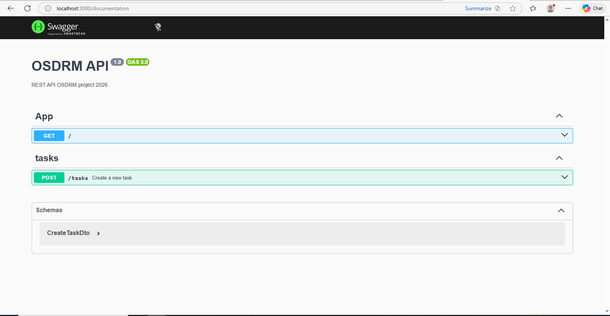

## API Documentation

This project uses **OpenAPI (Swagger)** for API documentation.

### Tools

- **@nestjs/swagger**
- **Swagger UI**
- **OpenAPI Specification**

### Accessing the documentation

Once the application is running, the API documentation is available at: http://localhost:3000/documentation

### Accessing screenshot of swagger ui

---

## Mail Notification

This project uses **MailHog** for the mail notification in local

## installation of mailhog (for each user)

if linux (in the terminal):
-Download Mailhog:
=> wget https://github.com/mailhog/MailHog/releases/latest/download/MailHog_linux_amd64

    -Make the binary executable:
    chmod +x MailHog_linux_amd64

    -Move the binary(Optional but recommended):
    => sudo mv MailHog_linux_amd64 /usr/local/bin/mailhog

    -execute:
    => mailhog
        Web interface : http://localhost:8025

if windows :

    -Download mailhog on https://github.com/mailhog/MailHog/releases
    => MailHog_windows_amd64.exe

    -install and web interface available on http://localhost:8025

.env need these variables:
MAIL_HOST=localhost
MAIL_PORT=1025
MAIL_SECURE=false
MAIL_FROM="Dev <dev@test.com>"

